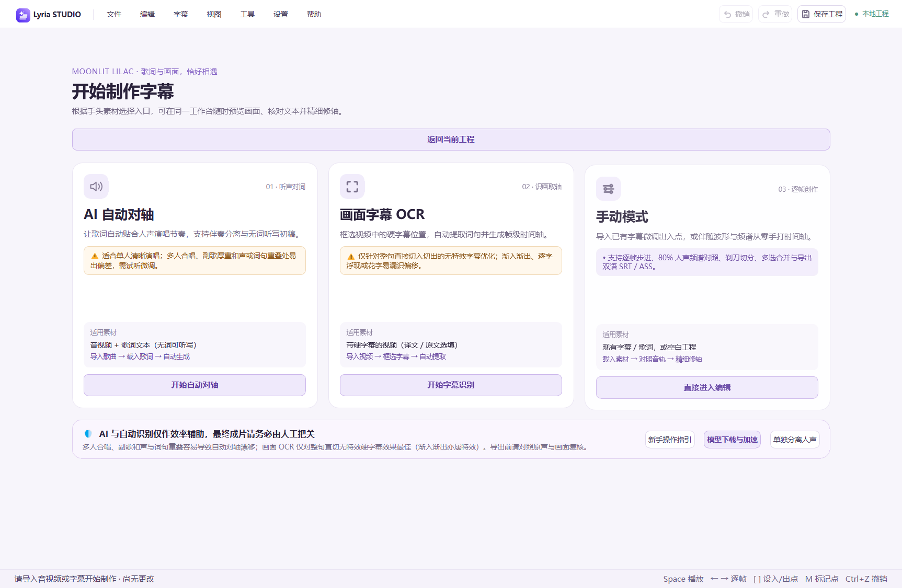
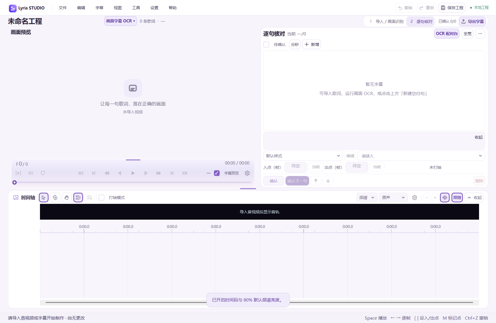
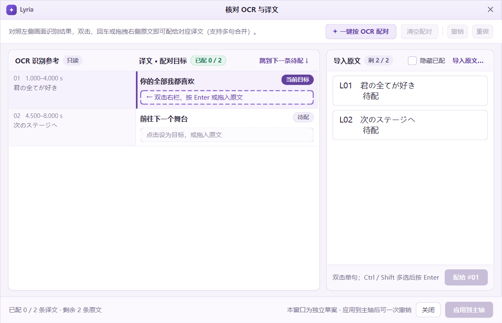
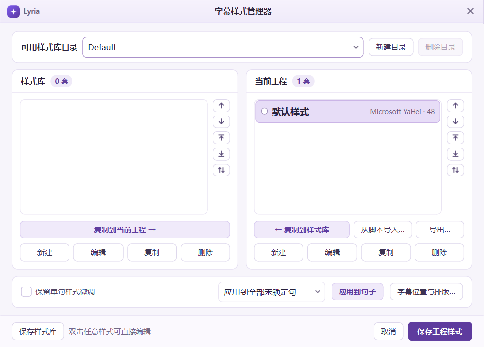
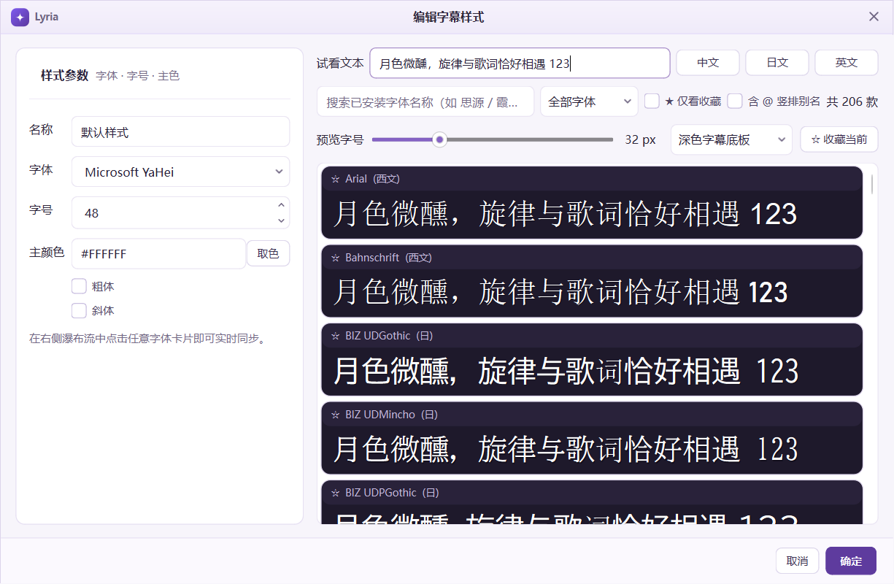

# Lyria STUDIO

面向 Windows 的本地歌词打轴、硬字幕 OCR 提取与双语字幕校对工具，基于 Qt Quick 与 Python 构建。

软件围绕视频画面、音轨波形/频谱与双语文本组织工作区，提供从自动生成时间轴初稿到逐帧校对、原译文配对及字幕导出的完整流程。当前版本为 **`v0.3.4` 测试版**。

## 下载与安装

普通用户无需配置 Python 环境，可直接前往 [Releases 页面](https://github.com/YukokuSuzuko/Lyria/releases) 下载 Windows 10 / 11（64 位）单文件安装程序：

- **`Lyria-v0.3.4-Beta-Setup-x64.exe`**：内置主程序、离线画面 OCR 组件与 DirectML 显卡基础加速运行库，支持安装至普通用户目录（无需管理员权限）。
- **可选本地模型**：人声分离（UVR）、日语歌词对齐（NextFire）与语音听写（Qwen3）等大体积模型不随安装包捆绑，安装后可在软件内「模型下载与加速」窗口按需下载（默认提供国内镜像源）或从本地文件夹导入。

## 工作流程

启动页与工作区左上角模式菜单提供三种制作入口，可根据手头素材切换：

1. **AI 自动对轴**：输入音视频与演唱原词，调用本地对齐模型生成句级时间轴（日语歌曲默认使用 `NextFire`，亦可选 `Qwen3`），支持先行分离伴奏以降低乐器干扰。
2. **画面字幕 OCR**：在视频预览中框选最多四个硬字幕区域，按设定采样率识别文字出现与消失的帧边界；识别结果可进入「OCR / 译文 / 原文」三栏配对台完成原译文对应。
3. **手动模式**：直接导入现有字幕、纯文本歌词或新建空白工程，对照视频画面、80% 默认增益频谱与音频波形手动打轴、切分、合并并调整样式。



## 主要功能

- **音画与频谱联动**：支持真实视频帧步进、音频波形与频谱视图切换（可切换查看原声或分离后人声），核对栏支持「帧数 / 分秒」显示并与时间轴刻度同步。
- **时间轴与多选编辑**：支持片段拖拽、入出点吸附、剃刀切分（`C`）、参考标记点（`M`）、`Ctrl / Shift` 多选合并及批量指定说话人或样式，编辑操作均接入撤销/重做栈。
- **原译文分离与配对**：演唱原文与中文译文独立存储，避免对齐模型误将译文当作演唱内容；配对工作台支持按 OCR 时间一键对应、手动拖拽拆合及整步撤销。
- **字幕样式与字体预览**：提供左右双栏「字幕样式管理器」（本地样式库与当前工程互传、目录管理、ASS 样式导入导出），内置带缺字检测与深浅底板切换的字体预览列表。
- **字幕导出**：支持导出 UTF-8（含 BOM）单语或双语 `.ass`、`.srt` 与 `.lrc` 文件，保留原始工程与导入素材不被覆盖。

| 校对主工作区 | OCR 与译文配对台 |
| :---: | :---: |
|  |  |

| 双栏字幕样式管理器 | 字体与样式实时预览 |
| :---: | :---: |
|  |  |

## 适用边界与注意事项

- **识别与对齐局限**：自动对轴在单人清晰演唱段落表现较好，多人合唱、厚重和声或词句交叠处容易产生漂移；画面 OCR 仅针对整句直切、无动态特效的硬字幕设计，渐入渐出、逐字浮现或复杂花字容易漏识或产生边界偏差。自动化结果仅作初稿辅助，成片导出前需人工复核。
- **按需下载模型的独立许可**：软件本体不包含外部大模型权重。在模型中心按需下载的 `NextFire/mms-300m-ForcedAligner-karaoke-ja-Latn` 模型权重遵循 **CC-BY-NC-SA-4.0（仅限非商业用途）**，不受本仓库软件源码 GPL-3.0 协议覆盖，使用前请留意模型页面所示许可条款。
- **测试版说明**：项目当前处于 `0.3.x` 公开测试阶段，工程格式与部分内部接口仍可能随后续版本演进调整，重要字幕工程建议定期备份。

## 从源码运行

开发环境需准备 Windows 10 / 11（x64）与 Python 3.12：

```powershell
python -m venv .venv
.\.venv\Scripts\Activate.ps1
python -m pip install -r requirements.txt

# 启动桌面端界面
python app_qt.py

# 运行无界面回归测试
$env:QT_QPA_PLATFORM = "offscreen"
python -m pytest
```

完整 Windows 独立安装包构建需额外准备本地外部运行资源目录（`resources/`，含 FFmpeg、RapidOCR 模型、Tesseract 及 DirectML 加速组件），构建约束见 [Windows 构建说明](docs/WINDOWS_BUILD_NOTES.md) 与 [构建与开发补充说明](docs/DEVELOPMENT.md)。

## 目录结构

- `app_qt.py`：Qt Quick 桌面端主程序入口
- `desktop_qt/`：Qt / QML 界面组件、控制器 `Bridge`、对话框、样式管理与字体预览
- `lyricsync/`：字幕数据模型、工程读写、导出器、画面 OCR 与音频对齐逻辑
- `design/`：应用图标与界面 SVG 图标资源
- `examples/`：合成演示字幕与工程样例
- `tests/`：后端与桌面界面自动化测试
- `packaging/`：Windows 打包脚本、Spec 配置与细分依赖锁定清单
- `tools/`：构建检查、隔离测试桌面与环境辅助脚本
- `docs/`：架构与第三方二进制对照说明文档
- `licenses/`、[第三方依赖说明](docs/THIRD_PARTY.md)：第三方依赖归属与许可证存档

## 许可证与第三方声明

- 本仓库自有源代码基于 [GNU General Public License v3.0 (GPL-3.0)](LICENSE) 发布，并附有针对系统及硬件加速运行库的 [GPL-3.0 第 7 条附加许可声明](licenses/ADDITIONAL_PERMISSION_RUNTIME.txt)。
- 源码依赖、字体使用边界与外部模型归属说明见 [THIRD_PARTY.md](docs/THIRD_PARTY.md) 及 [`licenses/`](licenses/) 目录。
- Windows 安装包内所含第三方二进制组件（Qt / PySide6 6.8.3、PyAV 16.0.1 及内置 FFmpeg 8.0 / x264 / x265、独立 FFmpeg CLI 9.0.2、DirectML 1.15.4 等）的版本记录、适用许可证及同页伴随上游源码包说明见 [二进制组件与源码对照清单](docs/THIRD_PARTY_BINARIES.md)。
